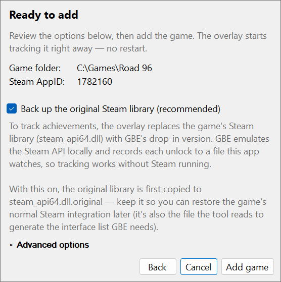

# Adding a game

For the overlay to show anything, each game needs a `steam_settings/achievements.json` next to the Steam DLL it loads. The app can generate this for you — right-click the tray icon and choose **Add game…** to launch a short wizard. It is a self-contained replacement for the unmaintained `generate_emu_config` tool.

## What the wizard asks

It only asks for what it cannot work out on its own, so a typical run is two or three pages.

1. **Game folder** — pick the game's install folder. The wizard works out which Steam DLL below it the game loads (even nested deep in an Unreal Engine or Unity layout, or behind a ColdClientLoader) and tries to detect the AppID, reading it from the CODEX/RUNE emulator's `steam_emu.ini` when the game runs one.
2. **Steam AppID** — shown only if the AppID could not be detected from the game folder. If a Steam store search guessed one, it is pre-filled for you to verify.
3. **Steam Web API key** — shown only the first time; it is saved to [`config.json`](configuration) and reused afterwards. Required for the achievement schema; get one at [steamcommunity.com/dev/apikey](https://steamcommunity.com/dev/apikey). The key is stored unencrypted — if that is a concern, revoke it right after the game is added. It is only needed while adding a game, and you will just enter a fresh one next time.
4. **Hidden achievements** — shown only if the game actually has hidden achievements and you have not already saved a Firecrawl API key. Steam blanks out the descriptions of secret achievements; the real text lives on SteamDB, behind Cloudflare, so the tool fetches it through [Firecrawl](https://firecrawl.dev), a hosted scraper. Paste a free Firecrawl API key, or leave it blank to skip — those descriptions then stay as placeholders.
5. **Ready** — review the summary and options (back up the original DLL, and an **Advanced** section for the GBE release folder), then click **Add game**. For a game running the CODEX or RUNE emulator the page shows **Replace it with GBE** instead; see [below](#games-running-codex-or-rune).

## What it then does

It fetches the achievement icons from Steam, downloads the matching GBE release, backs up and replaces the Steam DLL, and writes a `steam_settings/` folder with GBE's own overlay disabled — this app replaces it. A game that keeps its CODEX or RUNE emulator gets only the achievement list and icons; see [below](#games-running-codex-or-rune). So does a game that already runs GBE behind a ColdClientLoader, since its emulator is already in place. The final page shows live progress.

When it finishes, the game's folder is added to `gamesPaths` if it is not covered already (and, for a game keeping CODEX or RUNE, the emulator's save folder to `gseSavesPaths`), and the overlay starts tracking it immediately. No restart.

If a configuration already exists for the game, the wizard shows its location and asks before overwriting it.

## Games running CODEX or RUNE

Some games ship with the CODEX or RUNE Steam emulator in place of Steam's own library. That emulator records each unlock in an `achievements.ini` of its own, under `%PUBLIC%\Documents\Steam\RUNE` or `...\CODEX`, and the overlay reads it. So by default the wizard leaves the emulator alone: it writes only the achievement list and icons into `steam_settings/`, downloads nothing, and adds the emulator's save folder to `gseSavesPaths`, creating it if the game has never been launched.

Tick **Replace it with GBE** only if the game's achievements never appear. Some games record no unlocks under this emulator, and GBE does. The wizard then runs as it does for any other game, taking the list of Steam interfaces GBE needs from the emulator's `steam_emu.ini`.

## What can stop it

- **Denuvo games** do not load `steam_api64.dll` at all. If Denuvo is detected with no crack present, the tool stops before changing anything. A game that keeps its CODEX/RUNE emulator, or already runs GBE behind a ColdClientLoader, skips this check, since no GBE DLL is installed.
- **Games whose Steam library the wizard can't identify**: when several copies could be the one the game loads and nothing tells them apart, the folder page names them and stops. See [Which Steam DLL a game loads](../development/steam-dll-detection) for how it decides.
- **Games the wizard can't install GBE into**: a 32-bit game, and one that loads Steam through a ColdClientLoader whose library is not GBE. The wizard installs only GBE's 64-bit `steam_api64.dll`, and stops with the reason before changing anything.
- **Windows Defender** sometimes raises a false positive on current GBE releases as they download. The wizard offers to add the needed Defender exclusions (with a UAC prompt) and retries automatically. Alternatively, point the Advanced **GBE release folder** at an already-extracted release and uncheck "Download the latest GBE release".

## Doing it by hand

The [GBE reference](../development/gbe-reference) covers what the wizard is doing underneath — where unlocks are stored, the achievement schema format, why the overlay disables GBE's own, and why hidden achievement descriptions arrive blank. None of it is required reading for normal use.
